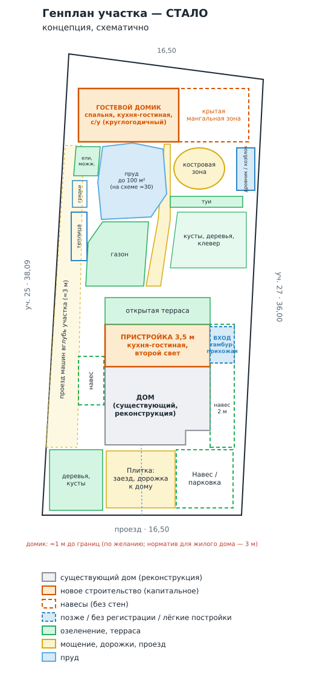

# PopovskyDom — перестройка семейного дома в СНТ «Кольчиха»

Реконструкция дома 2002 года (≈ 103 м²) в «современную небольшую усадьбу» (≈ 200 м²) для постоянной жизни родителей, плюс генплан участка и гостевой дом. Строим по этапам разными подрядчиками.

**Цель:** встретить 2029 год в новом доме.
**Статус:** этап 0 — сбор исходных данных, ТЗ архитектору (ноябрь 2026).



## Навигация

| Документ | Что внутри |
|---|---|
| [01 — Исходные данные](docs/01-ishodnye-dannye.md) | техпаспорт, участок, коммуникации, что ещё получить |
| [02 — Описание проекта](docs/02-opisanie-proekta.md) | цели, кто живёт, программа по уровням, участок, гостевой дом |
| [03 — Этапы и бюджет](docs/03-etapy-i-byudzhet.md) | 13 этапов, оценка стоимости, деньги, вывод по разрыву |
| [04 — ТЗ архитектору](docs/04-tz-arhitektoru.md) | задание на проект + что легко забыть |
| [05 — Подводные камни](docs/05-podvodnye-kamni.md) | риски по конструкциям, праву, инженерии, подрядчикам, деньгам |
| [06 — Вопросы архитектора](docs/06-voprosy-arhitektora.md) | ожидаемые вопросы и наши ответы |
| [07 — Перестроить или купить](docs/07-cheklist-perestroit-ili-kupit.md) | чек-лист решения A / B / C |
| [Открытые вопросы](docs/open-questions.md) | что ещё решить |
| [Журнал решений](docs/decisions.md) | что уже решили |
| [Схемы](schemes/README.md) | генплан, уровни 1–3 было/стало, разрез |

## Кратко о бюджете

Оценка дома до заезда — **≈ 16–29 млн ₽** (середина ≈ 22). Всё вместе с участком и гостевым домом — **≈ 22–41 млн ₽**. Есть **≈ 12–13 млн** на 2027–2028. Реалистично на 2027 год: проект, коробка и тёплый контур. Подробности и варианты — в [03](docs/03-etapy-i-byudzhet.md).

## Ближайшие шаги (2 недели)

1. Заказать выписки ЕГРН на участок и дом; подать запрос ГПЗУ через РПГУ МО.
2. Сдать воду из скважины на анализ.
3. Узнать статус газа: ТУ / договор догазификации.
4. Собрать референсы фасада → `source/referensy/`.
5. Ответить на [открытые вопросы](docs/open-questions.md) 1–12.
6. Собрать 5–7 архитекторов / бюро, отправить им ТЗ и запросить КП. Отдельно — КП на обследование, геологию и топосъёмку.
7. До конца ноября обсудить ТЗ с родителями и согласовать.

## Структура репозитория

```
docs/      — документы проекта (источник правды)
schemes/   — схемы SVG (генерируются tools/schemes.py)
source/    — исходники: техпаспорт 2016, эскизы владельца, референсы
tools/     — скрипты
AGENTS.md  — правила для агентов
```
