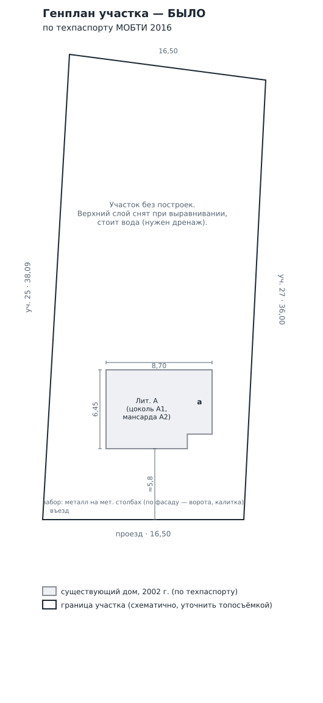
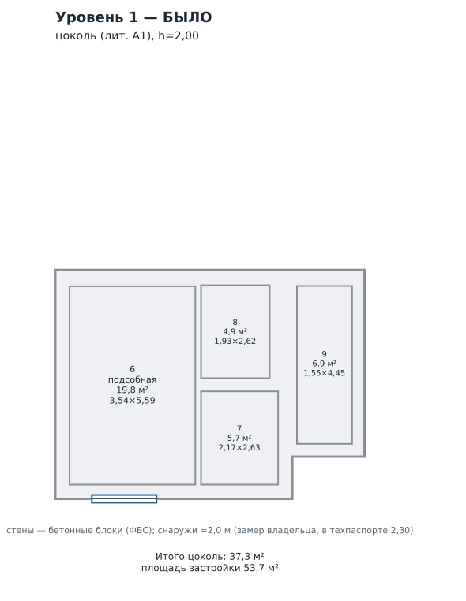
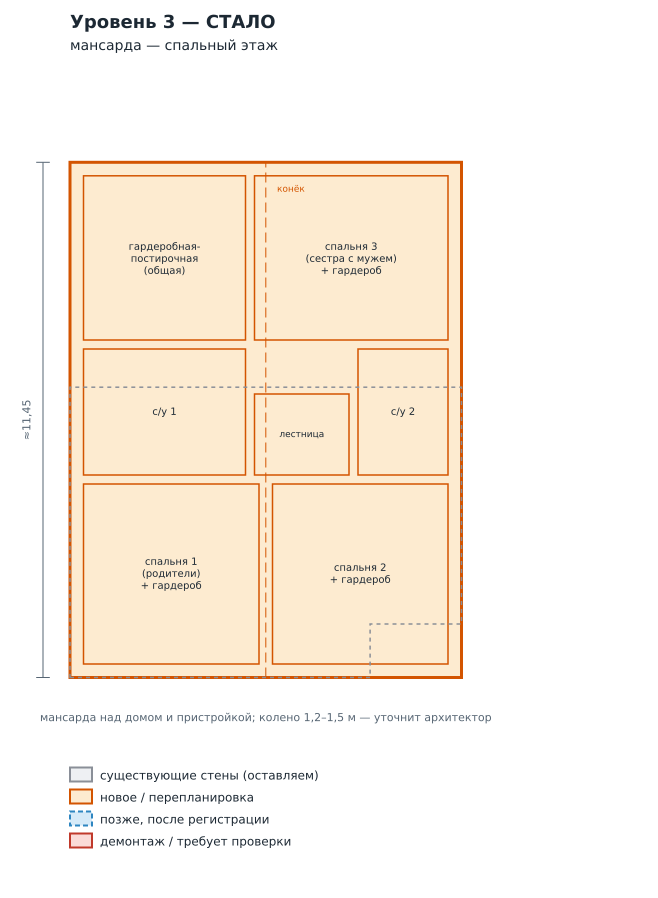
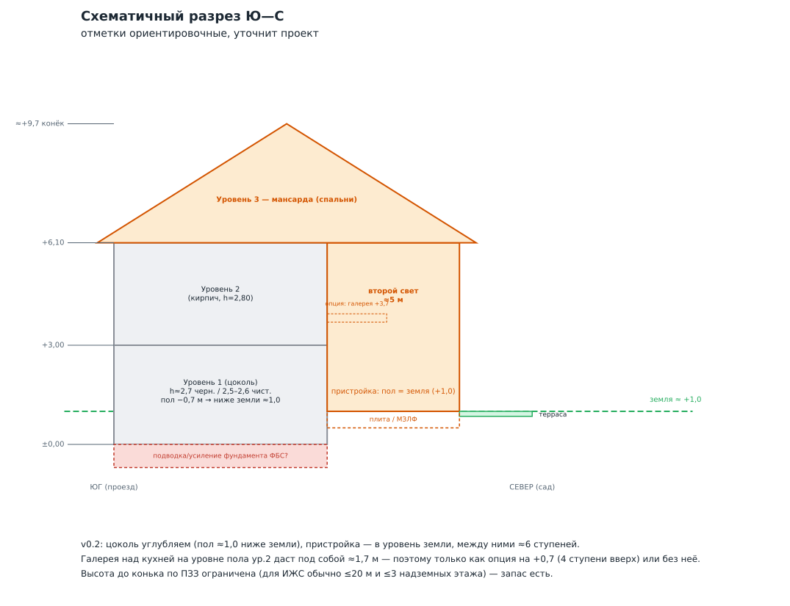
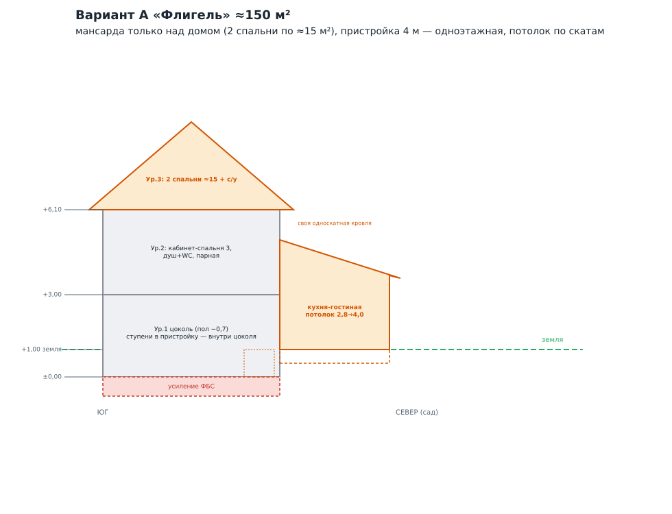
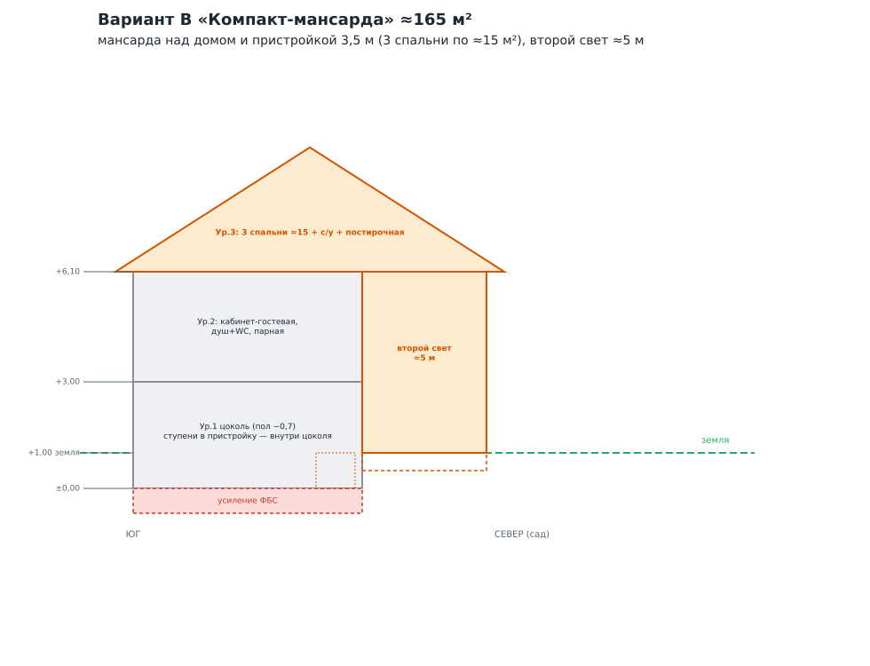

# Схемы

Все схемы **концептуальные**. Размеры существующего дома взяты из техпаспорта 2016 года, всё новое нарисовано по эскизам владельца. Точные привязки появятся после топосъёмки и проекта. Перегенерация: `python3 tools/schemes.py`.

Цвета: серый — существующее, оранжевый — новое, синий пунктир — позже или без регистрации, красный — демонтаж или требует проверки.

## Участок

| Было | Стало |
|---|---|
|  |  |

## Уровень 1 — цоколь + пристройка

| Было | Стало |
|---|---|
|  |  |

## Уровень 2 — бывший 1 этаж

| Было | Стало |
|---|---|
|  |  |

## Уровень 3 — мансарда

| Было | Стало |
|---|---|
|  |  |

## Разрез v0.2

## v0.3 — варианты компоновки

| A «Флигель» ≈ 150 м² | B «Компакт-мансарда» ≈ 165 м² |
|---|---|
|  |  |

PNG для отправки в мессенджеры — в [`png/`](png). Перегенерация после изменения SVG: `for f in schemes/*.svg; do rsvg-convert -w 1600 -b white "$f" -o schemes/png/$(basename "$f" .svg).png; done`.

Исходные эскизы владельца — [`../source/eskizy/`](../source/eskizy).
