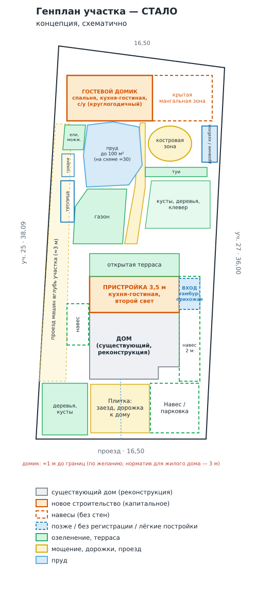
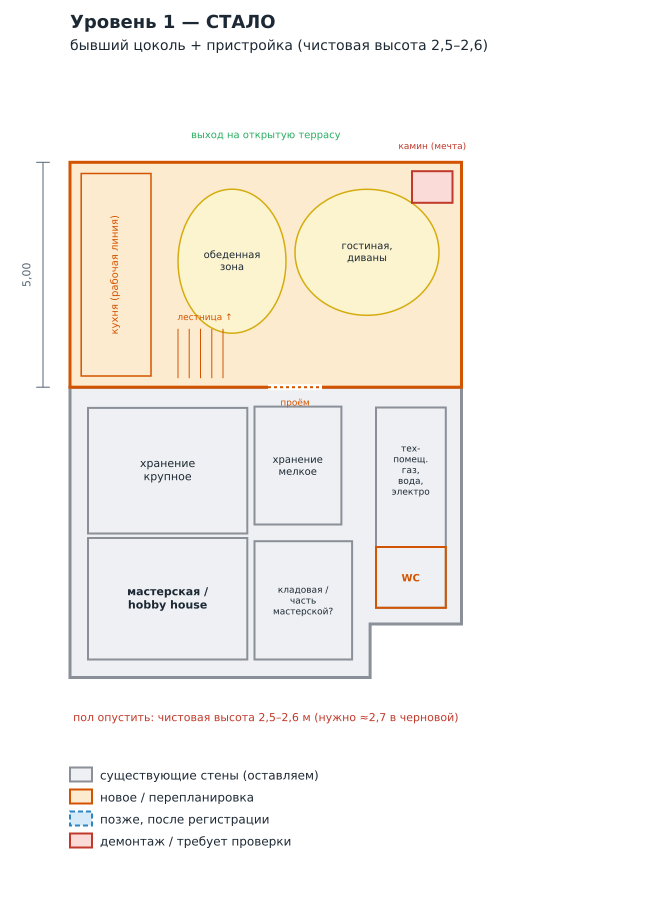
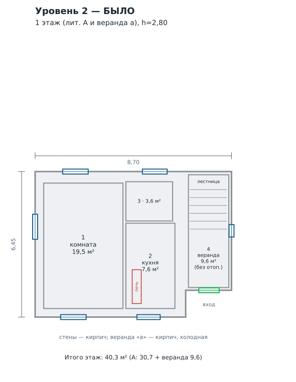
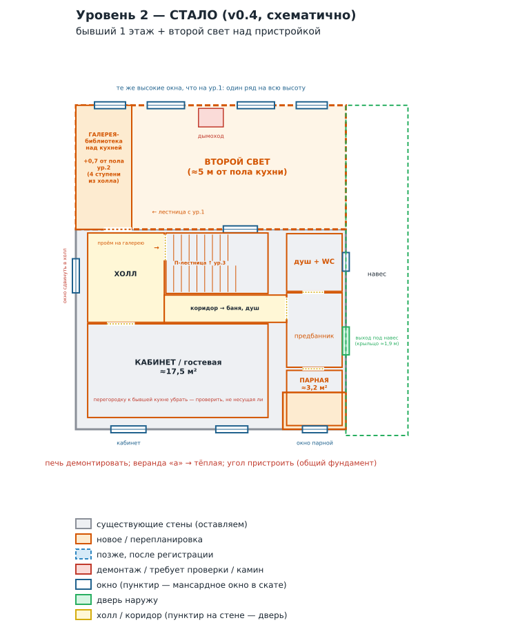
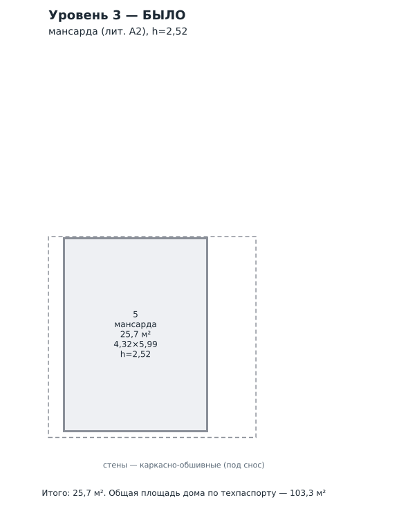

# Схемы

Все схемы **концептуальные**. Размеры существующего дома взяты из техпаспорта 2016 года, всё новое нарисовано по эскизам владельца. Точные привязки появятся после топосъёмки и проекта. Перегенерация: `python3 tools/schemes.py`.

Цвета: серый — существующее, оранжевый — новое, синий пунктир — позже или без регистрации, красный — демонтаж или требует проверки.

## Участок

| Было | Стало |
|---|---|
|  |  |

## Уровень 1 — цоколь + пристройка

| Было | Стало |
|---|---|
|  |  |

## Уровень 2 — бывший 1 этаж

| Было | Стало |
|---|---|
|  |  |

## Уровень 3 — мансарда

| Было | Стало |
|---|---|
|  |  |

## Разрез

Исходные эскизы владельца — [`../source/eskizy/`](../source/eskizy).
